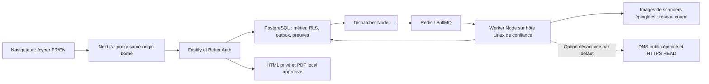

# Bump Cyber — état de livraison et limites

Dossier technique du **5 novembre 2026**. Le code réuni sur
`codex/cyber-workbench` contient les fondations privées, le moteur, les premiers
connecteurs, l’interface FR/EN et les rapports. Le code fonctionnel `72ecd41` a passé 327 unités, 198 intégrations,
8 scénarios natifs et 3 parcours Chromium. Les résultats réels et leurs
références sont consignés dans [CYBER_VALIDATION.md](CYBER_VALIDATION.md).

Aucun déploiement Cyber en production, donnée client réelle, scan public ou
abonnement payant n’a été engagé. Aucune nouvelle infrastructure Cyber n’a été
configurée dans Cloudflare. Les hooks existants créent leurs aperçus de branche
pour le site public ; les fichiers de `website/` restent inchangés. Le prototype
Loi 25 conserve ses routes et son moteur. La matrice distingue les capacités
livrées, leurs limites et les conditions préalables à un usage client.

## Les 16 livrables demandés

| N°  | Livrable                           | Réalisation et limite vérifiable                                                                                                                                                                                                                                          |
| --- | ---------------------------------- | ------------------------------------------------------------------------------------------------------------------------------------------------------------------------------------------------------------------------------------------------------------------------- |
| 1   | Plan et architecture               | Monolithe modulaire, API et worker séparés, PostgreSQL existant et runner Linux de confiance. [Architecture](CYBER_ARCHITECTURE.md), schéma ci-dessous et [plan](CYBER_PLAN.md).                                                                                          |
| 2   | Technologies réellement employées  | TypeScript strict, Node/pnpm, Next/React, Fastify, Better Auth, PostgreSQL/Drizzle, Redis/BullMQ, Zod, Docker, Vitest, Playwright et PDFKit ; versions détaillées ci-dessous.                                                                                             |
| 3   | Outils OSS installés et versions   | Images Semgrep 1.183.0, Trivy 0.76.1 et Gitleaks 8.30.1 préparées et épinglées par digest. Leur disponibilité dépend des limites effectives du daemon ; les résultats natifs CI ne valent pas disponibilité sur le runner local sans cgroups.                             |
| 4   | Outils seulement prévus distingués | ZAP, Nuclei, Prowler, Nmap, Greenbone et osquery ne sont pas installés ni connectés ; Wazuh et DefectDojo restent optionnels. Betterleaks a été étudié sans installation.                                                                                                 |
| 5   | Schémas et migrations              | Tables Cyber et migrations additives `0006` à `0008`, avec références tenant/client, RLS, immuabilité et identité MFA ; détail ci-dessous. Pas de table de credentials cloud ni de second modèle d’identité.                                                              |
| 6   | Code interface/backend             | Route privée `/cyber` FR/EN, assistant d’audit, clients/actifs/mandats, revue, actions, retests, comparaison et rapports ; routes Fastify protégées et proxy Next borné. [Parcours livré](CYBER_WORKBENCH.md).                                                            |
| 7   | Connecteurs fonctionnels           | Trois moteurs hors ligne, import JSON natif et SARIF 2.1.0, contrôles DNS/HTTPS passifs désactivés par défaut. Profils révisés et couverture bornée ; huit scénarios natifs réels ont été vérifiés dans la CI Linux conforme.                                             |
| 8   | Tests et résultats                 | Unités, intégrations PostgreSQL/Redis/S3, Chromium, huit scénarios natifs réels et parcours Docker import/PDF. Les commits, décomptes, liens GitHub et limites exacts sont consignés dans [les preuves](CYBER_VALIDATION.md).                                             |
| 9   | Installation locale                | Bootstrap Node/pnpm, environnements locaux/de test, PostgreSQL/Redis, migrations, clés et outils puis `/cyber`. Commandes reproductibles dans [CYBER_OPERATIONS.md](CYBER_OPERATIONS.md).                                                                                 |
| 10  | Configuration Docker               | Compose local de base et extension Cyber pour imports/PDF ; scanners dans des conteneurs isolés démarrés par le worker Node hôte. Le worker applicatif conteneurisé n’a ni client ni socket Docker.                                                                       |
| 11  | Exploitation et arrêt              | Capacités réelles, actualisation Trivy sans jobs actifs, annulation par job, arrêt d’urgence par organisation, arrêt des processus et suppression ciblée d’un éventuel conteneur résiduel. Volumes et clés conservés.                                                     |
| 12  | Mesures de sécurité                | Session vérifiée, email confirmé, rôles, mandat approuvé, vérifications répétées, RLS, sources chiffrées, preuves minimisées, contrôles HTTP et scanner confiné. La sécurité de production reste à valider indépendamment.                                                |
| 13  | Coûts et limites connus            | Aucun abonnement requis ; matériel, stockage, sauvegardes et exploitation restent à financer. Dimensionnement estimé, limites de taille/durée et portée des moteurs documentés ci-dessous.                                                                                |
| 14  | Liens de PR                        | Lots [#38](https://github.com/MarcSaad-Hadidi/Bump-Inc/pull/38) à [#42](https://github.com/MarcSaad-Hadidi/Bump-Inc/pull/42), plus [#43](https://github.com/MarcSaad-Hadidi/Bump-Inc/pull/43) pour la validation intégrée vers main et CodeQL. Aucune fusion automatique. |
| 15  | Fonctionnalités restantes          | Scans actifs/authentifiés/cloud, credentials de scanners, gros imports, portail client, automatisation de la rétention et intégrations avancées restent à réaliser. Liste détaillée ci-dessous.                                                                           |
| 16  | Blocages de production             | Access/IdP éventuel, HTTPS, bootstrap des comptes, politique MFA, secrets/rotation, restaurations, rétention et validation du runner restent à approuver et tester. Aucun état « prêt production » n’est revendiqué.                                                      |

## Architecture et technologies exécutées

PostgreSQL fait autorité ; Redis transporte les notifications de jobs. L’outbox,
les tentatives et leurs jetons empêchent qu’une notification ou une tentative
périmée décide seule du résultat. Les frontières restent celles du workspace
existant : `packages/identity`, `contracts`, `core`, `db`, `integrations`, puis
`apps/api`, `apps/worker` et `apps/web`. Aucun microservice ni backend métier
parallèle n’est ajouté.

| Technologie              | Version de référence | Usage réel                                          |
| ------------------------ | -------------------- | --------------------------------------------------- |
| Node.js / pnpm           | 24.22.1 / 10.34.7    | Runtime et gestion du workspace                     |
| Next.js / React          | 16.4.2 / 19.3.1      | Interface privée et proxy serveur                   |
| Fastify / Better Auth    | 5.12.7 / 1.7.12      | API, sessions, organisations et MFA TOTP            |
| PostgreSQL / Drizzle ORM | 17 / 0.45.4          | Persistance, migrations SQL et autorisations tenant |
| Redis / BullMQ           | 7 / 5.81.5           | Transport et exécution asynchrone                   |
| Zod / TypeScript         | 4.6.7 / 5.9.3        | Validation des frontières et typage strict          |
| Vitest / Playwright      | 4.1.12 / 1.64.1      | Unités, services réels et navigateur Chromium       |
| PDFKit                   | 0.20.2               | PDF A4 local avec police et licence embarquées      |

Les versions exactes des dépendances et images restent celles des manifestes,
du lockfile et du [registre des scanners](../apps/worker/src/cyber/registry.ts).
L’interface et l’API sont du code fonctionnel, sans résultat ni progression
simulés : une observation arrive à examiner ; une confirmation est humaine.

## Modèle PostgreSQL et migrations

Le [schéma Drizzle Cyber](../packages/db/src/cyber-schema.ts) réutilise les
organisations, membres, sessions, engagements versionnés et exécutions existants.

| Objet métier             | Persistance et responsabilité                                                                                                                        |
| ------------------------ | ---------------------------------------------------------------------------------------------------------------------------------------------------- |
| Client / Asset           | `cyber_client`, `cyber_asset` : contact habilité, criticité, rétention et cible exacte avec exposition                                               |
| AuditMandate             | `cyber_mandate` lié à `engagement` et ses versions/approbations : signataire, autorisation, responsable, fenêtre, moteurs, exclusions et urgence     |
| Audit / ScanJob          | `cyber_audit`, `cyber_scan` liés à `execution_job` : idempotence, actif/moteur/source, état enregistré, version et couverture                        |
| Source / Evidence        | `cyber_source`, `cyber_evidence` : contenus chiffrés, SHA-256, contexte tenant, expiration et purge                                                  |
| Observation / Finding    | `cyber_observation` conserve les observations ; `cyber_finding` regroupe par empreinte et porte revue, état, impact et ajustement métier             |
| RemediationTask / Retest | `cyber_task`, `cyber_retest` : responsable, échéance, action, audit de contrôle et conclusion humaine                                                |
| Report                   | `cyber_report` : instantané typé, provenance/résolution, langue, empreinte et approbation du contenu exact                                           |
| AuditEvent / rôles       | `cyber_event`, événements d’organisation/exécution et `cyber_role` : traçabilité et affectations consultant/analyste/réviseur                        |
| ScannerConnector         | Registre statique `SCANNER_DESCRIPTORS` et adaptateurs de code ; aucune table ni configuration exécutable fournie par l’utilisateur                  |
| CredentialReference      | Non implémenté : aucun scanner authentifié ou cloud n’est activé. L’identité Better Auth et la clé du coffre ne sont pas des credentials de scanner. |

Les clés étrangères composites imposent le même tenant et le même client pour
les liens métier. Les tables Cyber ont une RLS forcée et les transactions
revalident l’appartenance courante avec `withTenant`. Le runtime `bump_app`
n’est pas propriétaire ; les migrations utilisent un credential opérateur séparé.

| Migration additive                                                                               | Effet                                                                                                                                                    |
| ------------------------------------------------------------------------------------------------ | -------------------------------------------------------------------------------------------------------------------------------------------------------- |
| [0006_cyber_domain.sql](../packages/db/migrations/0006_cyber_domain.sql)                         | Tables Cyber, contraintes, index, droits et RLS ; historique d’observations/mandats/retests/événements append-only                                       |
| [0007_cyber_reporting_controls.sql](../packages/db/migrations/0007_cyber_reporting_controls.sql) | Protection des instantanés/empreintes de rapport et de la provenance ; écritures runtime limitées aux champs prévus pour approbation, exécution et purge |
| [0008_identity_mfa.sql](../packages/db/migrations/0008_identity_mfa.sql)                         | État MFA du compte et table globale `two_factor` de Better Auth, avec droits du plugin ; les tables métier conservent leur RLS                           |

Les migrations SQL historiques ne sont pas réécrites. Le migrateur réconcilié
compare les hashes, sérialise l’opération et refuse une lignée inconnue ; une
base historique doit être inspectée avant upgrade. La table MFA est globale
comme l’identité et les sessions, sans modèle tenant artificiel. Son secret et
ses codes sont chiffrés par Better Auth avec `AUTH_SECRET`, distinct de
`CYBER_EVIDENCE_KEY_FILE` pour les preuves Cyber.

## Connecteurs, preuves et interprétation

| Moteur livré    | Licence du dépôt vérifiée | Portée réelle                                                                                                                                 |
| --------------- | ------------------------- | --------------------------------------------------------------------------------------------------------------------------------------------- |
| Semgrep 1.183.0 | LGPL-2.1                  | Trois règles locales Python/JS/TS ; aucun pack cloud ni conclusion d’exploitation                                                             |
| Trivy 0.76.1    | Apache-2.0                | `fs` sur dépendances/configurations des fichiers fournis, avec base d’avis hors ligne ; pas d’analyse d’image de conteneur ou de compte cloud |
| Gitleaks 8.30.1 | MIT                       | Répertoire de fichiers, règles épinglées et rédaction native des valeurs de secrets ; aucune vérification d’un credential réel                |
| JSON / SARIF    | Parseurs du projet        | Enveloppe JSON native versionnée ou profil SARIF 2.1.0 borné ; provenance déclarée, jamais preuve d’installation native                       |
| Web passif      | Connecteur du projet      | Option opérateur désactivée : A/AAAA publics, HTTPS `HEAD /`, TLS et TXT/SPF/DMARC ; pas de redirection suivie ni de scan actif               |

Les trois images officielles sont épinglées par SHA-256 complet dans le registre ;
`--pull=never` est imposé aux jobs. Les notices, licences, versions des outils
seulement envisagés et conditions de redistribution sont recensées dans
[CYBER_SCANNERS.md](CYBER_SCANNERS.md). Ni un tag seul ni une version importée
ne remplace cette identité. Les textes et snippets bruts ne deviennent pas des
preuves exportées ; les CVE, versions affectées/corrigées, CVSS et références
disponibles sont conservés sous forme minimisée.

Le risque conserve la sévérité technique et explique les contributions de
l’exposition, criticité, confiance, contrôles compensatoires et ajustement
humain. EPSS et CISA KEV restent inconnus sans source vérifiée. Une absence de
résultat, un échec ou une couverture réduite ne vaut pas correction. Les
rapports privés séparent constats examinés, éléments à examiner et faux positifs.
Le PDF exige une approbation de l’empreinte exacte ; les snapshots v1 restent
lisibles et les nouvelles rédactions v2 conservent provenance et résolution.

Le profil livré dans `f0d4043` ajoute l’inventaire natif Trivy à l’empreinte et
un délai interne au conteneur indépendant de la survie du worker. Il intègre
`041faad`, qui refuse qu’une alerte encore présente sous une autre version ou
à une autre ligne soit interprétée comme corrigée. Son profil Trivy v3 distingue
la perte d’un composant/contrôle d’un upgrade ou d’un passage FAIL vers PASS et
refuse les inventaires incomplets. Les huit tests natifs de ce profil ont réellement réussi, dont la perte de
couverture Trivy et l’arrêt après interruption du contrôleur ; le journal indique
la version testée. Une ancienne réussite ne valide pas automatiquement une mise
à jour d’image, de règles ou de runner.

## Installation, Docker, exploitation et coûts

Le parcours de référence est décrit dans [CYBER_OPERATIONS.md](CYBER_OPERATIONS.md) :
versions Node/pnpm, copies locales des exemples, installation figée,
`pnpm infra:up`, compilation, migration opérateur, `cyber:init`, `cyber:tools`,
puis `pnpm dev` et `http://127.0.0.1:3000/cyber`. Mailpit à `127.0.0.1:8025`
permet la vérification email locale. L’inscription n’est activée que par le
drapeau local ; le bootstrap du premier compte de production n’est pas livré.

Les moteurs natifs exigent un worker Node hôte et un daemon Linux avec cgroups
CPU/mémoire/swap/PID, seccomp et init Docker. Chaque conteneur utilise un utilisateur non root,
un filesystem en lecture seule, aucun réseau, aucune capability, 1 CPU,
1536 Mio, 128 PID et un tmpfs borné. Le contrôle de disponibilité refuse toute
exécution moins confinée. Le Compose applicatif reste adapté aux imports et
PDF avec une clé bind-mount privée ; il ne donne pas le socket Docker à l’API.
Une machine locale sans cgroups n’est pas une plateforme native acceptée.

Les fichiers natifs sont limités à 100, 128 Kio chacun et 512 Kio sérialisés au
total, sans ZIP ni clone distant. Les imports sont bornés à 512 Kio, les jobs
à 30 secondes, les sorties à 1 Mio et les observations à 1000. Le navigateur
montre les étapes réelles ; le rôle requis peut annuler un job ou activer l’arrêt
d’urgence de son organisation. Ctrl+C puis l’arrêt Compose conservent les volumes.
Un conteneur résiduel est traité par son nom vérifié, sans suppression globale.

Aucun abonnement n’est nécessaire au parcours auto-hébergé. Comme hypothèse de
dimensionnement non mesurée : 4 vCPU, 8 Gio RAM, 16 Gio recommandés et au moins
10 Gio libres ; la base Trivy observée représente environ 1,7 Gio, hors images,
dépendances et sauvegardes. Le matériel, l’électricité, le stockage, le trafic
d’actualisation et le temps opérateur ont un coût réel. Ni ce dimensionnement
ni le plan gratuit d’un fournisseur futur ne constituent une capacité garantie.

## Mesures livrées, restant et production

Sont présents : email vérifié, sessions contrôlées en base, MFA TOTP optionnel,
rôles serveur, mandat approuvé par le propriétaire, responsable désigné,
vérifications pendant les jobs, RLS, contrôles Origin/Host, proxy borné,
chiffrement AES-256-GCM des contenus et preuve exportée minimisée. Les contrôles
SSRF refusent les réponses privées mixtes et épinglent l’adresse HTTPS ; les
tests de transport sont synthétiques, sans cible publique scannée.

Restent hors livraison : scanners actifs, authentifiés et cloud ; gestion de
CredentialReferences ; nouveaux moteurs avancés ; analyse d’images de
conteneur ; clone/ZIP/gros volumes ; portail client ; enrichissements EPSS/KEV ;
extension du catalogue Semgrep au-delà des trois règles révisées ;
rotation automatique des clés ; purge planifiée ; politique complète
d’effacement des rapports, historiques et sauvegardes ; politique MFA obligatoire.
La récupération des fichiers temporaires déchiffrés après SIGKILL du worker
demande encore une procédure opérateur et un espace temporaire privé en mémoire
ou chiffré ; le watchdog arrête le conteneur sans purger son répertoire hôte.
Les limites HTTP en mémoire nécessitent aussi une coordination partagée avant
plusieurs instances API. Les listes initiales sont bornées et ne constituent
pas une pagination destinée à de gros volumes. La comparaison livre les
observations nouvelles, persistantes ou non observées et les changements de
couverture. Les regroupements historiques complets des corrections/réouvertures,
les actifs ajoutés et une courbe de risque figée par audit restent à développer ;
aucune courbe ni amélioration n’est déduite artificiellement d’un nombre réduit.

La rétention de 1 à 365 jours s’applique aux nouveaux contenus du client. Une
purge administrateur explicite efface les ciphertexts expirés et conserve leur
provenance ; elle ne supprime pas les snapshots de rapports ni les historiques.
Sauvegarder PostgreSQL et les clés séparément et tester leur restauration.
Remplacer `AUTH_SECRET` ou la clé de preuve sans migration de clés peut rendre
les données concernées illisibles. Aucune rotation automatique n’est livrée.

La production reste bloquée tant que ne sont pas validés : identité/IdP et
Access éventuel, origine HTTPS et protection de l’accès direct, comptes initiaux
et récupération, politique MFA, SMTP TLS, credentials DB/Redis chiffrés en transit,
secrets et rotation, runner isolé réellement vérifié, sauvegarde/restauration,
rétention/archivage, revue indépendante et autorisation d’infrastructure. Voir
[CYBER_CLOUDFLARE.md](CYBER_CLOUDFLARE.md) pour la passerelle envisagée, sans
ressource créée ni scanner dans Workers. Les tests synthétiques ne valident ni
un périmètre réseau client ni une conformité juridique.

## Lots de PR et reprise de validation

| PR                                                         | Périmètre                                                                   |
| ---------------------------------------------------------- | --------------------------------------------------------------------------- |
| [#38](https://github.com/MarcSaad-Hadidi/Bump-Inc/pull/38) | Réconciliation de la fondation, identité, mandats, exécution et ingestion   |
| [#39](https://github.com/MarcSaad-Hadidi/Bump-Inc/pull/39) | Modèle et services métier Cyber, isolation et règles de revue/retest        |
| [#40](https://github.com/MarcSaad-Hadidi/Bump-Inc/pull/40) | Connecteurs natifs/imports/passifs et confinement des scanners              |
| [#41](https://github.com/MarcSaad-Hadidi/Bump-Inc/pull/41) | Rapports privés HTML/PDF, provenance et approbation                         |
| [#42](https://github.com/MarcSaad-Hadidi/Bump-Inc/pull/42) | Interface FR/EN de consultation, MFA et parcours Chromium                   |
| [#43](https://github.com/MarcSaad-Hadidi/Bump-Inc/pull/43) | Validation de la pile vers main : CodeQL, dépendances et contrôles intégrés |

L’état GitHub et les derniers hashes doivent être relus avant toute intégration.
La validation finale doit rattacher unités, services réels, E2E, natifs, Compose,
audit des dépendances et secrets à **la même tête finale**. Les résultats effectifs et les contrôles encore indisponibles figurent dans le
journal de validation ; aucune publication ni fusion automatique n’est effectuée.
