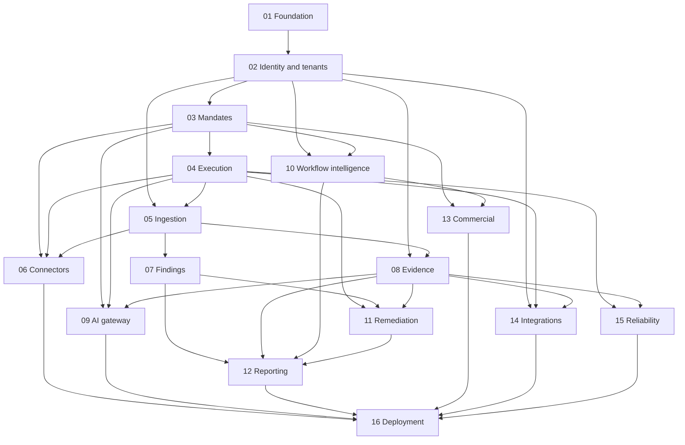

# Bump OS PR roadmap

Every row is a separate reviewable feature boundary. PR01 [#1](https://github.com/MarcSaad-Hadidi/Bump-Inc/pull/1), PR02 [#2](https://github.com/MarcSaad-Hadidi/Bump-Inc/pull/2) and PR03 [#3](https://github.com/MarcSaad-Hadidi/Bump-Inc/pull/3) have passed their gates and were observed merged on 2026-10-22. [Roadmap PR04 / GitHub #5](https://github.com/MarcSaad-Hadidi/Bump-Inc/pull/5) is **READY FOR REVIEW**, unmerged on verified `5939330`. PR04 implementation `eee336b` passed CI 39867661216; [execution validation](EXECUTION_VALIDATION.md) records the evidence. PR05 [GitHub #12](https://github.com/MarcSaad-Hadidi/Bump-Inc/pull/12) stacks on #5; functional `ea8f736` passed full CI39872257617 with 173 units, 117 integrations, Chromium, Compose, audit and secrets. See [its acceptance record](INGESTION_VALIDATION.md) for exact evidence and limitations. PR06–16 remain planned and unimplemented. [PROGRESS.md](PROGRESS.md) tracks this continuation; the user requested stopping after PR05.

| PR  | Capability                              | Direct prerequisites   | Acceptance evidence                                                                                                                                                   |
| --- | --------------------------------------- | ---------------------- | --------------------------------------------------------------------------------------------------------------------------------------------------------------------- |
| 01  | Project Foundation                      | None                   | Reproducible install, checks/build, real PostgreSQL/Redis integration, worker completion, health failure tests, browser smoke, dependency and secret scans, opened PR |
| 02  | Identity, Organizations & Multi-Tenancy | 01                     | Proven identity provider, secure sessions, invitations/RBAC, cross-tenant denial tests, RLS evaluation, admin audit events                                            |
| 03  | Engagement & Authorization Engine       | 02                     | Versioned mandates, expiry/exclusion checks, explicit approval and out-of-scope refusal tests                                                                         |
| 04  | Distributed Execution Engine            | 03                     | Persistent jobs, retry/backoff, idempotence, cancellation, timeouts, dead-letter flow, emergency stop and interruption/concurrency tests                              |
| 05  | Universal Audit Ingestion               | 02, 04                 | Canonical observations, JSON/SARIF/SBOM validation, provenance, limits, protected local/S3 storage, duplicate-import tests                                            |
| 06  | Open Source Security Connectors         | 03, 04, 05             | Confined Semgrep/Trivy/Gitleaks adapters, permissions, limits, normalized results and fixture tests; future adapters only documented                                  |
| 07  | Finding Intelligence Engine             | 05                     | Deterministic correlation/scoring, uncertainty states, human confirmation, history, retest/closure criteria                                                           |
| 08  | Evidence & Audit Trail                  | 02, 05                 | Integrity hashes, append-only event controls, tenant access, secret redaction, retention, controlled export and tamper tests                                          |
| 09  | AI Gateway & Agent Infrastructure       | 03, 04, 08             | Provider/agent/tool registries, validated outputs, prompt versions, budgets/costs, evaluations and sensitive-action approvals; no model training                      |
| 10  | Workflow Intelligence Engine            | 02, 03                 | Process steps, observed/assumed cost inputs, deterministic ROI, automation priorities, before/after and decision history                                              |
| 11  | Remediation Engine                      | 04, 07, 08             | Confirmed-finding tasks, assignment, approval, acceptance checks, retest and verified closure; no automatic production deployment                                     |
| 12  | Professional Reporting Engine           | 07, 08, 10, 11         | Versioned reproducible FR/EN HTML/PDF, authorized evidence, uncertainty labels, publication approval and redaction tests                                              |
| 13  | Commercial & Project Engine             | 03, 10                 | Minimal CRM, estimates/pricing/margins, proposal-to-project conversion, milestones, deliverables and recurring packages; estimates distinguished from contracts       |
| 14  | Integration Hub                         | 02, 04, 08             | Signed webhooks, external credentials, idempotent sync/mapping, provider limits, retries and event history                                                            |
| 15  | Observability & Reliability             | 04, 08                 | OpenTelemetry, correlation, metrics/traces, alerts, backup/restore drill, incident runbook and measured load/recovery targets                                         |
| 16  | Production Deployment & Hardening       | 06, 09, 12, 13, 14, 15 | Authorized staging/production configuration, external secrets/TLS, CI/CD, migrations/rollback, E2E/security/load/restore gates                                        |

The graph lists direct dependencies, including authorization before any execution engine. Transitive prerequisites apply automatically. A later-numbered PR can proceed before an earlier independent one once every prerequisite is verified.

## Review and stacking rules

1. Name the first PR `chore: initialize Bump OS production foundation`; use a dedicated `codex/` branch.
2. A PR is **DRAFT** while required implementation or validation is incomplete, **BLOCKED** when a missing dependency or permission prevents progress, and **READY FOR REVIEW** only after required checks succeed.
3. Open PR 01 before starting dependent implementation. An unverified foundation is not a valid stacked base.
4. Branch dependent work from a verified prerequisite branch and target that branch in GitHub. Record the dependency PR links and exact verified commit in the description. Rebase and rerun affected checks when a base changes; retarget after merge.
5. Use separate worktrees and exclusive file ownership for independent agents. Coordinate shared schemas/contracts before edits. Never create incompatible parallel copies of a shared foundation.
6. Never auto-merge, disable branch protection, silently deploy, or label unverified work production-ready.

Each PR description records delivered behavior, architecture changes, tests actually run and their results, migration steps, risks, limitations, reproduction commands, and next dependencies. Draft PRs identify missing checks explicitly. Session reports include actual PR links, completed features, test evidence, remaining problems, blocking dependencies, and the next priority.

## Current delivery gate

Foundation implementation commit `39eba332430568d331e459b2b7ebcd412b444549` passed every gate in CI run 39840127776: 33 unit tests, 5 real-service integration tests, 1 Chromium E2E, Compose startup, dependency audit threshold and secret scan. No PR has been merged.

PR 02 adds library-backed identity, verified email, database sessions, organizations, owner/admin/member checks, invitations, scoped settings, forced RLS and transactional administrative events. SMTP delivery uses local Mailpit for validation. Acceptance rejects invitations after inviter demotion/removal; reissuing creates a fresh invitation under the current actor. See [the identity API](IDENTITY.md) and [ADR 0002](adr/0002-identity-and-tenant-isolation.md).

PR 02 implementation commit `215e98cd07da310714583c686470b1aef365fdf2` passed CI run 39844381812: 63 unit tests, 27 real-service integration tests, 1 Chromium test, full Compose SMTP/authentication smoke, dependency audit threshold and secret scan. Evidence is recorded in [identity validation](IDENTITY_VALIDATION.md). Production onboarding, MFA, owner transfer, organization/account deletion and external mail-provider setup are explicitly outside this slice. PR 03 uses this verified base; PR 04 must preserve its current membership checks.

PR 03 implements immutable mandate revisions, exact declared scope/exclusions, plaintext authorization evidence, owner approval, responsible-operator checks, expiry and irreversible revocation. Commit `88187826e609d6d58603e4179df231100413ade6` passed CI run 39847356527: 116 unit tests, 45 real-service integration tests, 1 Chromium test, full Compose mandate lifecycle, dependency audit threshold and secret scan. Its documentation head `6b8562f8e0db378f8fc129e4f577f9aa10499f6a` also passed CI 39847969234, checked during the PR04 continuation. See [acceptance evidence](ENGAGEMENT_VALIDATION.md). PR04's durable execution implementation rechecks that policy per attempt; its own required service-backed validation remains a separate gate before dependent PR05 begins.
